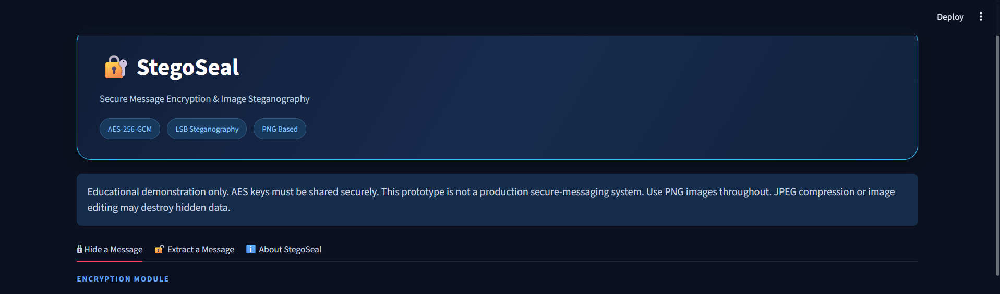
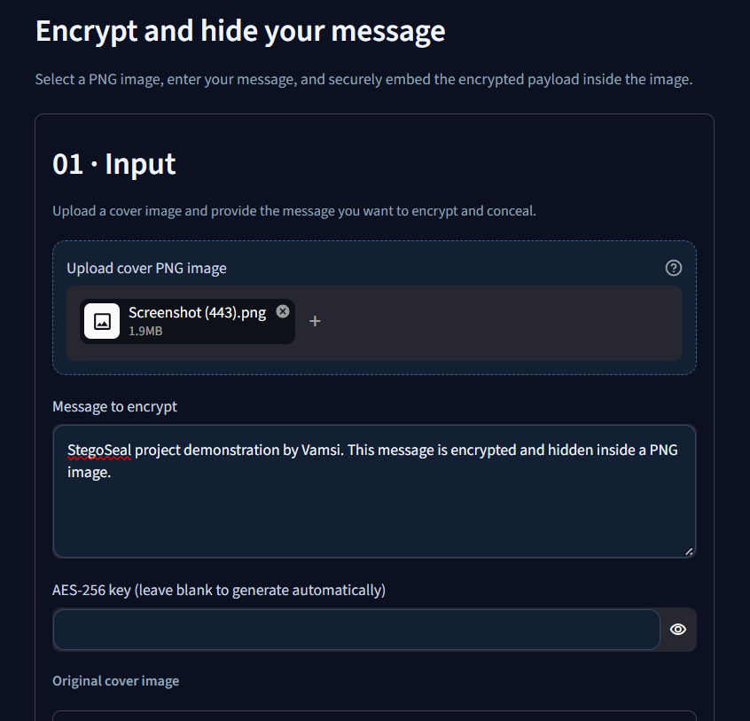
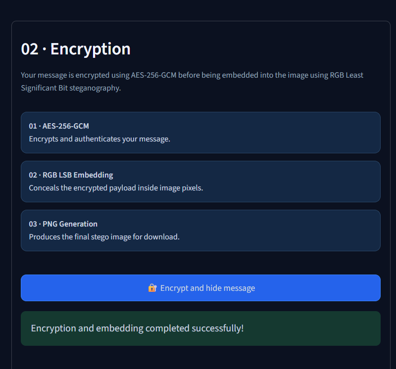
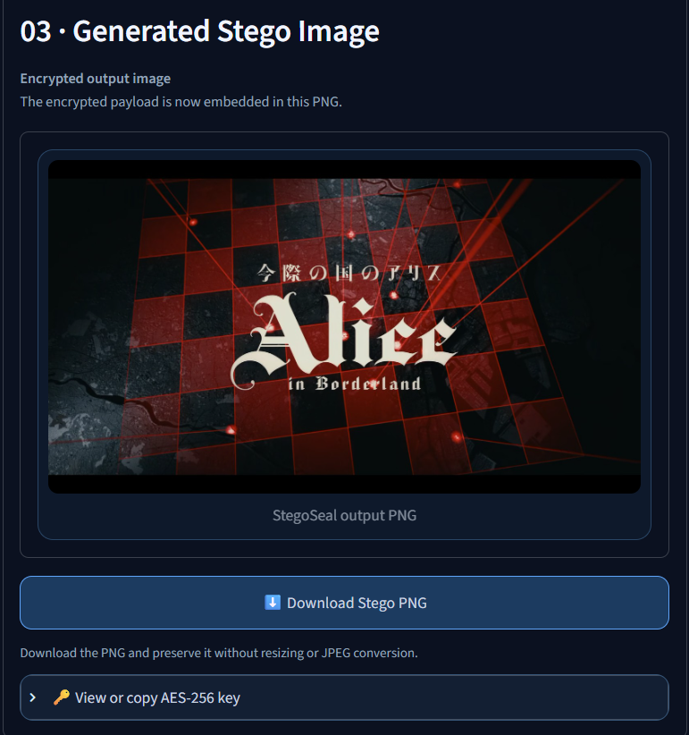
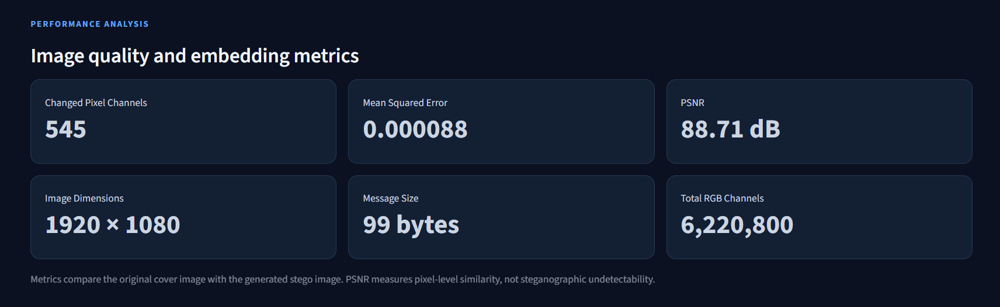
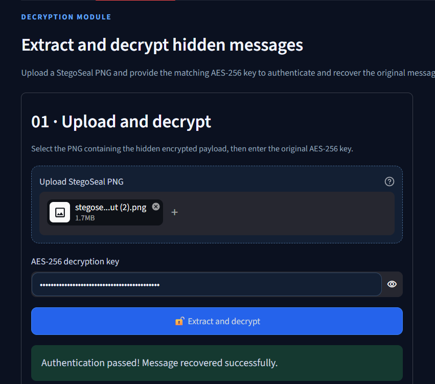
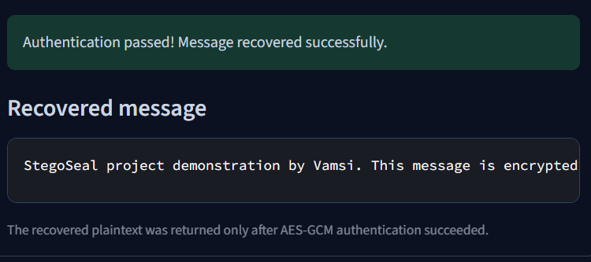

# StegoSeal

**StegoSeal** is an educational Python web application that encrypts text messages using **AES-256-GCM** and hides the resulting authenticated ciphertext inside RGB PNG images using **Least Significant Bit (LSB) steganography**.

The project demonstrates how cryptography and image steganography can be combined to provide message confidentiality and conceal the presence of a message within an image.

## Features

- **AES-256-GCM Encryption:** Authenticated encryption of text messages.
- **RGB LSB Steganography:** Embeds encrypted payload bits into RGB pixel channels.
- **PNG Image Processing:** Generates downloadable stego images while preserving the image format.
- **Message Extraction and Decryption:** Recovers and decrypts hidden messages using the correct AES key.
- **Authentication Verification:** Detects incorrect keys and modified encrypted payloads.
- **Performance Metrics:** Displays image dimensions, message size, changed pixel channels, MSE, and PSNR.
- **Tampering Demonstration:** Illustrates how payload modification affects authentication and recovery.

## Application Screenshots

### 1. Home Interface


### 2. Encryption Input


### 3. Encryption Output


### 4. Download Stego Image


### 5. Performance Metrics


### 6. Decryption Interface


### 7. Recovered Message


## Technology Stack

- **Language:** Python
- **Web Framework:** Streamlit
- **Cryptography:** AES-256-GCM
- **Steganography:** RGB Least Significant Bit (LSB)
- **Image Processing:** Pillow
- **Testing:** Python unittest

## Run on Windows

### Prerequisites

- Python 3.10 or newer
- pip

### 1. Clone the repository

```powershell
git clone https://github.com/krishnavamsi-nitw/stegoseal.git
cd stegoseal
```

### 2. Create and activate a virtual environment

```powershell
py -m venv .venv
.\.venv\Scripts\Activate.ps1
```

### 3. Install dependencies

```powershell
python -m pip install -r requirements.txt
```

### 4. Launch the application

```powershell
python -m streamlit run app.py
```

The application will open in your browser.

## How It Works

1. **Message Input:** Enter the text message and upload a PNG cover image.
2. **Encryption:** Generate or provide an AES key and encrypt the message using AES-256-GCM with a fresh 96-bit nonce.
3. **Embedding:** Store the encrypted payload in the RGB channels of the cover image using LSB substitution.
4. **Download:** Download the generated stego image and securely retain the AES key.
5. **Extraction:** Upload the stego PNG and provide the corresponding AES key.
6. **Decryption:** Extract the hidden payload, verify its authentication tag, and recover the original message.

## Design Notes

- AES-GCM uses a fresh 96-bit nonce for each message.
- The encrypted envelope contains a version marker, nonce, and ciphertext with a 128-bit authentication tag.
- The image frame stores a marker and a four-byte payload length before the encrypted envelope.
- Each payload bit replaces one RGB channel's least significant bit.
- Payloads exceeding the image's available capacity are rejected before embedding.
- The output must remain in PNG format. JPEG compression, resizing, color transformations, and other image modifications can corrupt the hidden payload.

## Run the Checks

Run the project's unit tests from the repository root:

```powershell
python -m unittest -v test_stegoseal.py
```

## Security Considerations

StegoSeal is a **classroom and educational prototype**, not a production secure-messaging system.

- The AES key must be shared securely between sender and receiver.
- Anyone possessing the correct key and stego image can recover the message.
- LSB steganography does not guarantee resistance to steganalysis.
- Image transformations and lossy compression can destroy embedded data.
- The application demonstrates authenticated encryption and basic steganography rather than providing a complete secure communication protocol.

## Evaluation

The implementation can be evaluated using different PNG dimensions and message lengths.

Relevant measurements include:

- Payload capacity
- Number of changed RGB channels
- Mean Squared Error (MSE)
- Peak Signal-to-Noise Ratio (PSNR)
- Successful message recovery
- Wrong-key rejection
- Tampering detection
- Handling of insufficient image capacity

For reproducibility, record the machine specifications and software versions used during evaluation.